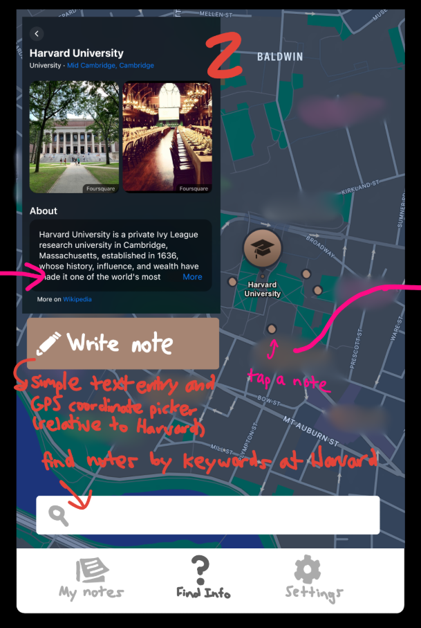
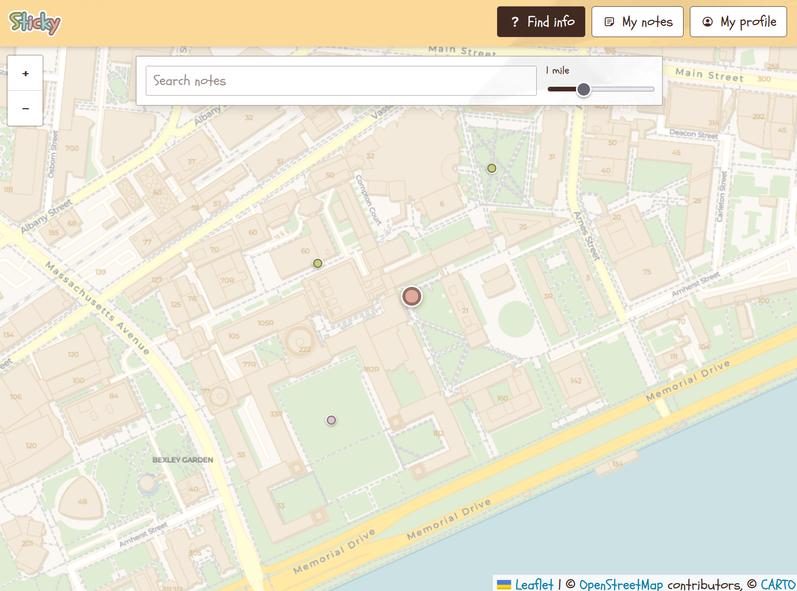

# Design Document
Sticky is a web-app that helps people navigate daily tasks (e.g. booking an appointment or boarding a train) through user-contributed sticky notes written on a global map. Instead of relying on non-specific or vague instructions on the internet, users can get advice relevant to the exact location that they need to traverse.

From P1 to P4, the problem domain, solution proposal, and concept design of Sticky remained unchanged. The design instead evolved in the visual presentation and features implemented: 

## Refinement of app identity from R1/P1 to P2/P3
In R1, I underspecified the stakeholders of my app. This led to the design drafts lacking identity and focus on a target audience. Even though I had identified the primary stakeholders in P1, it wasn't until P2 and P3 where I consciously integrated that information into the app; I placed a strong emphasis on creating a graphical user interface that was calming, inviting, and as simple to navigate for users as possible. As far back as P2, I integrated paper textures and hand-written fonts to create a warm atmosphere to potentially stressed users. In P3, I went further by using my color visual study to introduce pleasing colors without making Sticky too stimulating to users.

## Changes in features from R1 to P3
When I first planned the design of Sticky, I envisioned that the app would be able to denote "places" on the map (i.e. markers on the map for establishments such as a particular restaurant or university). This would be useful for organizing notes internally (with the Labeling concept) and allowing users to search through notes by place (with the Querying concept). 

By P2, I discovered that the APIs for places (such as Google Maps' API) were much more expensive and limited than those for map images alone. I scrapped places and instead allowed users to place notes directly onto the map. They could still search for notes, but the search feature instead filtered notes by physical distance. Thankfully, both the Labeling and Querying concepts were general enough to work in the final app without major revisions. The Labeling concept was repurposed into the "bookmark notes" feature (each user has a label corresponding to their collection of notes). 

| First draft (made by hand) | Live app in P4 |
| :---: | :---: |
|  |  |

## Concept design evolution
In P1, I had five concepts planned for Sticky:
- EmailAndPasswordAuthenticating
- GeographicPosting
- Labeling
- Querying
- Upvoting

In the end, I had nine concepts implemented:
- Authenticating (from ConceptBox)
- Consenting (from ConceptBox); used for requesting location from the user
- Federating (from ConceptBox)
- GeographicPosting
- Labeling
- Querying 
- Registering (from ConceptBox)
- Sessioning (from ConceptBox)
- Upvoting

The core concepts remained mostly unchanged, besides minor details to implement them in the sync engine. The additional concepts were ported from ConceptBox to implement a more versatile log-in and sessioning system. Instead of an email and password, users can now log-in with either their Commons account (Federating) or a username and password (Registering).